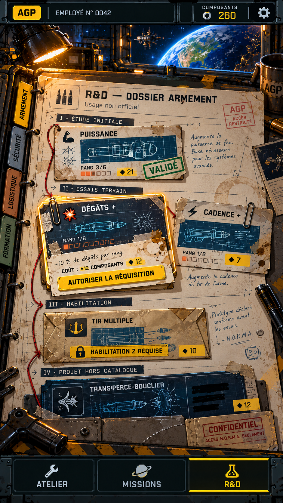

# R&D — le dossier de cartes techniques

Concept généré le 27 octobre 2026 à partir de l'écran R&D actuel et de la nouvelle direction du menu Missions.

## Intention

La R&D devient le bureau des archives techniques de l'AGP. Le joueur ne consulte plus une grille d'éléments d'interface : il ouvre un dossier physique et découvre une succession de cartes qui raconte la naissance d'un équipement.

Le parcours d'une branche suit quatre chapitres :

1. **Étude initiale** — le premier plan, annoté puis validé.
2. **Essais terrain** — des variantes testées, abîmées et corrigées.
3. **Habilitation** — un prototype placé sous scellé tant que le palier précédent n'est pas atteint.
4. **Projet hors catalogue** — une technologie confidentielle partiellement dissimulée.

Le fil rouge, les flèches au crayon, les trombones, les tampons et les traces d'essai créent une continuité narrative entre les cartes. Chaque objet donne l'impression d'avoir circulé dans les services de l'AGP.

## Cohérence avec les autres menus

- Même en-tête AGP, compteur de composants et réglages que l'écran Missions.
- Même hangar orbital en arrière-plan, avec lumière ambre et lumière froide de la planète.
- Même navigation basse ATELIER · MISSIONS · R&D.
- Jaune réservé à la sélection, aux coûts et à l'action principale.
- Métal sombre et éléments pixel art pour le cadre ; papier, plans bleus et tampons pour l'identité propre de la R&D.

## Grammaire proposée

| Fonction actuelle | Traduction visuelle |
|---|---|
| Département | Intercalaire latéral de classeur |
| Habilitation | Chapitre du dossier |
| Compétence | Carte technique physique |
| Rang | Cases imprimées ou perforations sur la carte |
| Compétence achetée | Tampon VALIDÉ |
| Verrouillage | Enveloppe scellée avec condition écrite |
| Coût | Étiquette de réquisition jaune |
| Sélection | Carte légèrement soulevée et éclairée |
| Achat | Bon « AUTORISER LA RÉQUISITION » |
| Voie spécialisée | Plan confidentiel rangé dans une pochette |

## Règles pour une future intégration

- Les cartes doivent être des composants dynamiques. Les noms, descriptions, rangs, coûts et états ne doivent pas être imprimés dans les images.
- Produire séparément les fonds de papier, les plans bleus, les tampons, les attaches et les pochettes. Les assembler en HTML/CSS afin de conserver les interactions et la lisibilité.
- La branche reste linéaire dans le défilement vertical, mais la composition alterne cartes simples, paires d'essais et enveloppes afin d'éviter l'effet de grille.
- La carte sélectionnée doit conserver une grande cible tactile sans nécessiter un bouton « + » sur chaque fiche.
- Une seule action d'achat forte est affichée à la fois, sur le bon de réquisition de la carte sélectionnée.
- Les autres départements restent visibles comme intercalaires et peuvent défiler verticalement ou horizontalement selon la place disponible.
- N.O.R.M.A. intervient par annotations manuscrites courtes. Les plaisanteries ne doivent pas masquer une condition de déblocage.
- Respecter le mouvement réduit : pas de flottement permanent. Une carte peut se soulever brièvement à la sélection et un tampon peut apparaître lors d'un achat.

## Éléments à produire

1. Fond de dossier ouvert et surface du bureau, sans texte.
2. Intercalaires de département avec couleurs contrôlées.
3. Trois familles de cartes : papier technique, plan bleu, fiche confidentielle.
4. Pochette verrouillée et sceau d'habilitation.
5. Tampons VALIDÉ, REFUSÉ et HORS CATALOGUE.
6. Trombones, ruban, fil rouge et annotations en calques décoratifs.
7. Icônes techniques des compétences existantes, harmonisées dans une même densité pixel.

La maquette est une proposition de composition. Elle ne modifie pas encore le jeu et ses valeurs ne doivent pas remplacer les données existantes.
