# Direction artistique « AGP-OS » — première proposition

Space Shooter X n'est plus un shooter spatial générique : le joueur est **un employé de l'AGP** (Agence Galactique de Propreté, an 2247) aux commandes d'une camionnette pourrie. Toute l'interface est le **logiciel de bord interne de cette entreprise** : **AGP-OS 9.4**.
Branche : `direction-agp` (l'ancienne interface reste sur `main`). Aucune mécanique, aucun équilibrage, aucune sauvegarde, aucune logique de compétence n'a été modifié : ce sont des textes, du CSS et des habillages.

## 1. L'idée en une phrase
**Un logiciel d'entreprise vieillissant, mais vivant.** Jaune de chantier + noir graphite + vert phosphore de terminal, des formulaires, des tampons, du papier listing à perforations, et une assistante administrative (N.O.R.M.A.) qui commente tout avec politesse et froideur.

## 2. Identité graphique

| Rôle | Couleur | Usage |
|---|---|---|
| Jaune sécurité `#ffc21a` | marque AGP, action principale | boutons, rayures de chantier, onglet actif, composants ◆ |
| Vert phosphore `#5dffa0` | « tout va bien » | coque saine, ordres exécutés, notes de N.O.R.M.A. |
| Orange `#ff7a2b` / rouge `#ff4438` | alerte, accident | coque en danger, incident majeur, « accident du travail » |
| Bleu acier `#7fc8ff` | champ de sécurité (bouclier) | jauge de bouclier |
| Sarcelle `#3fe0c5` | formation (XP) | grade, ordres de formation |
| Papier `#e9e2c8` + encre `#1c211d` | documents imprimés | rapport d'intervention |
| Graphite `#070a09` | fond | partout |

**Typographie** (les deux polices déjà dans le jeu, hiérarchie nouvelle) : *Press Start 2P* 5-12 px, majuscules, espacées, pour les **étiquettes et titres** (« OBJECTIF », « RISQUE ») · *VT323* 15-24 px pour les **valeurs et le texte** (ce qu'on lit vraiment).
**Motifs** : rayures de chantier jaune/noir (séparateurs, onglet actif, bouton, bandeau d'incident) · lignes de formulaire pointillées · coins de cadre · tampon · papier listing à perforations · curseur de terminal.
**Ton** : l'humour est dans les *détails* (contrôle technique « EXPIRÉ », « ASSURANCE DOMMAGES 0 % », département « Physique fondamentale — 1 stagiaire »), jamais dans la mise en page : tout reste lisible.

## 3. Écran par écran

### Chargement — démarrage d'AGP-OS
L'image de la camionnette en fond, le logo, et une barre qui égrène des lignes de boot : « VÉRIFICATION DE L'ASSURANCE… », « CONTRÔLE TECHNIQUE : EXPIRÉ (IGNORÉ) », « LECTURE DU CONTRAT (NON LU) »…

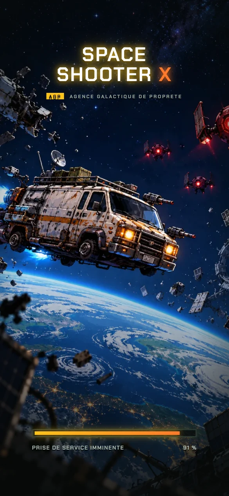

### Accueil — le poste de travail
- **En-tête** : logo AGP, « EMPLOYÉ N° 4 471 902 », compteur **COMPOSANTS** (les fragments), réglages.
- **Bandeau d'information** : un message à la fois (avis de l'AGP, RH, sécurité, N.O.R.M.A., « note interne » qui laisse deviner la conspiration), qui défile s'il est long. C'est la **vie de fond** de l'accueil, discrète.
- **Onglets** : ATELIER · MISSIONS · R&D (rayure de chantier sous l'onglet actif).

| MISSIONS — formation obligatoire | MISSIONS — ordre n°03 |
|---|---|
| 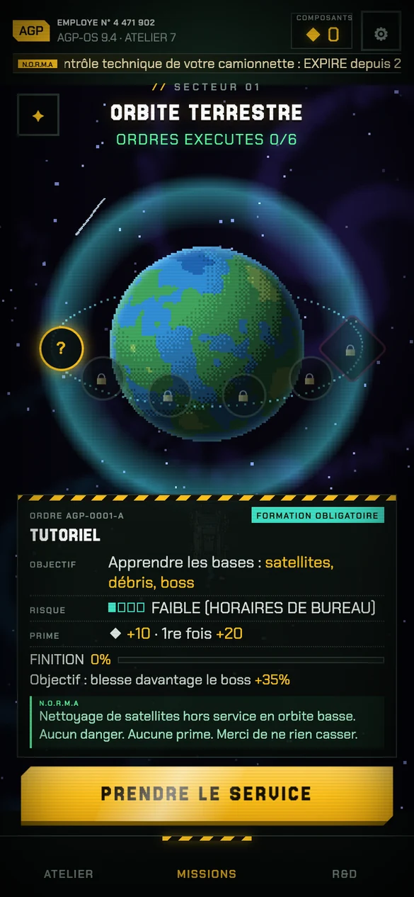 | 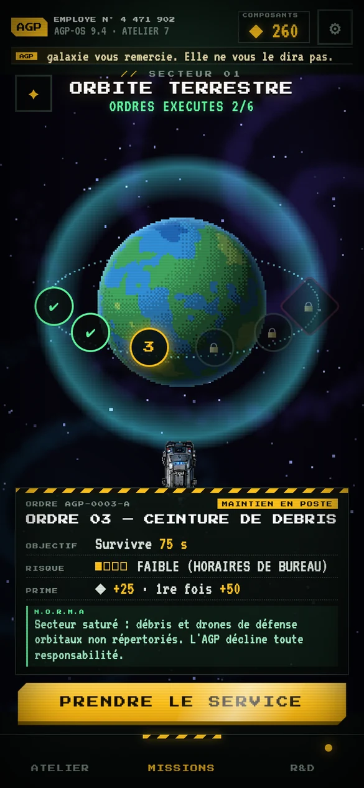 |

**Les mondes deviennent des *secteurs d'intervention*, les niveaux des *ordres de mission*, les boss des *incidents majeurs*.** La fiche du niveau est un **ordre de mission** : n° de dossier (`AGP-0003-A`), nature (« MAINTIEN EN POSTE », « FORMATION OBLIGATOIRE », « INCIDENT MAJEUR »), objectif, **risque** (4 pastilles + « FAIBLE (HORAIRES DE BUREAU) »), prime, et la **note de service de N.O.R.M.A.** Le bouton devient **PRENDRE LE SERVICE** (ou REFAIRE L'INTERVENTION, ou ACCÈS REFUSÉ).

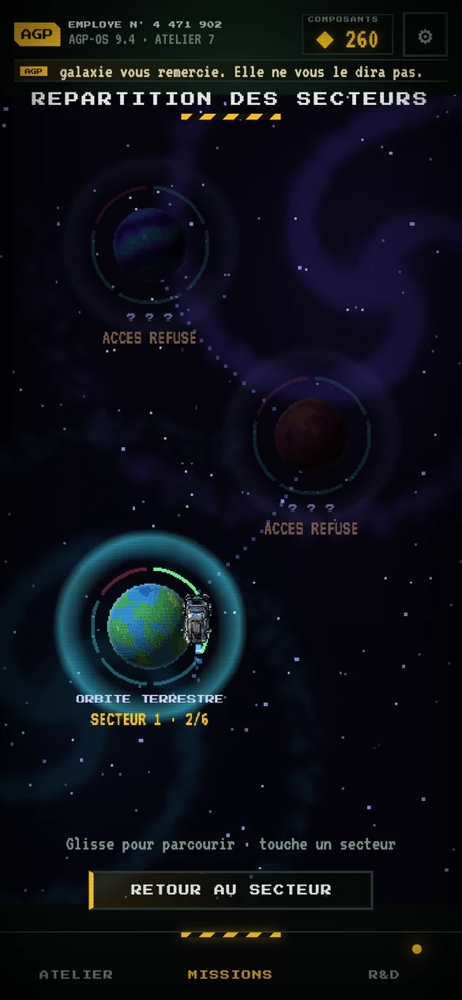
La carte stellaire devient la **répartition des secteurs** (« ACCÈS REFUSÉ » pour un secteur verrouillé ; toast « habilitation insuffisante »).

### Atelier — l'espace personnel
La camionnette au centre, sa plaque (« HOMOLOGATION II · contrôle technique : EXPIRÉ »), les livrées, puis une **fiche technique** : INTÉGRITÉ COQUE · CHAMP DE SÉCURITÉ · CHARGE PAR TIR · CADENCE DE TIR · BUSES ACTIVES · **ASSURANCE DOMMAGES**. Onglet MODULES = le matériel installé.

| Fiche technique | Modules installés |
|---|---|
| 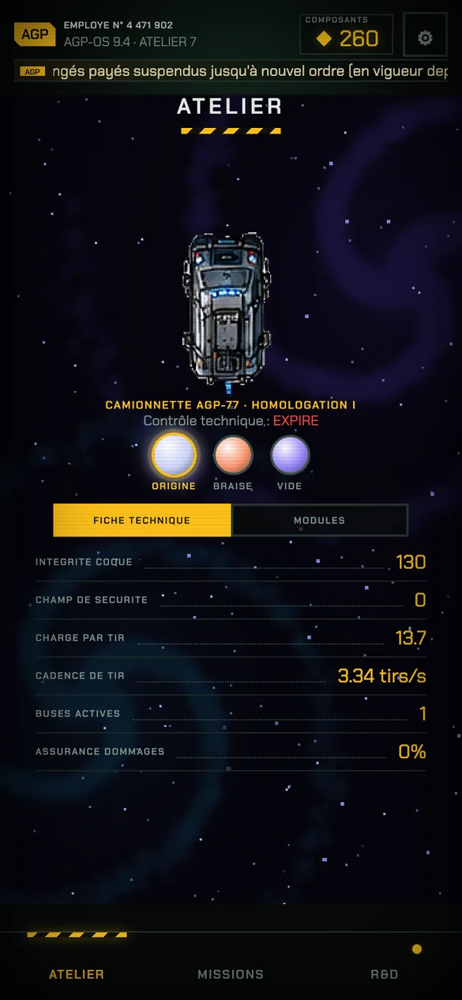 | 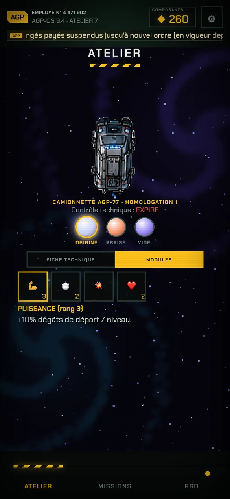 |

### R&D — le catalogue technique
Même logique que l'arbre en cartes, présentée comme un **catalogue** : chaque branche est un **département** (ARMEMENT « usage non officiel », SÉCURITÉ AU TRAVAIL « dernier service consulté », LOGISTIQUE, FORMATION CONTINUE, PHYSIQUE FONDAMENTALE « 1 stagiaire »…), les paliers sont des **habilitations**, les voies spécialisées des **projets hors catalogue**.

| Catalogue | Département Sécurité |
|---|---|
| 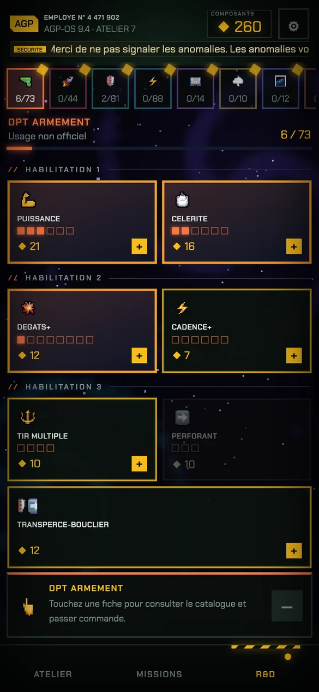 | 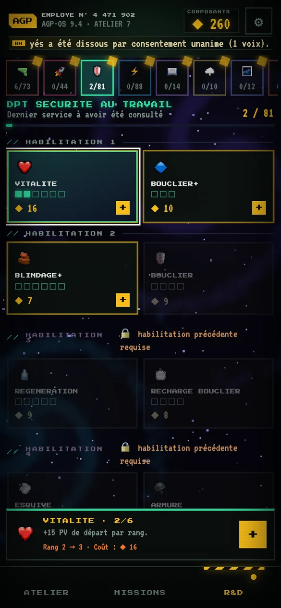 |

## 4. Le HUD en combat
Principe : **rien d'opaque, rien au milieu de l'écran**, tout est dans la bande du haut.

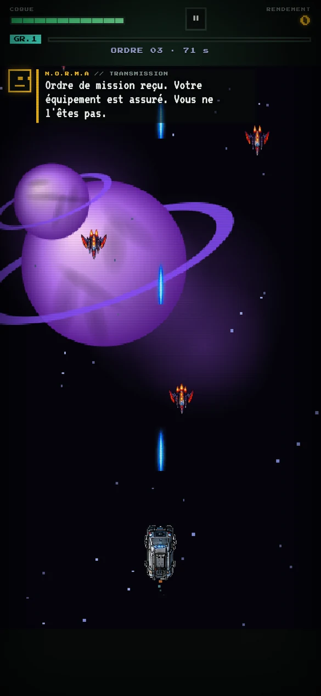

- **COQUE** (PV) : jauge segmentée, **verte → orange → rouge** selon l'état (lisible d'un coup d'œil), traînée claire sur les dégâts, clignotement sous 30 %. **Champ de sécurité** (bouclier) en bleu acier, fin, dessous.
- **RENDEMENT** (score) en jaune à droite ; **GR.n** (grade) + barre de formation (XP) en sarcelle ; **ORDRE 03 · 68 s** (mission) en gris discret.
- **Transmission de N.O.R.M.A.** : bandeau semi-transparent à gauche, sous la barre (déplacé sous la jauge d'un boss, et sous le guide du tutoriel). Elle s'écrit lettre par lettre, reste ~4 s, **ne se répète pas** et n'apparaît jamais pendant les cartes, la pause ou l'écran de fin.
- **Incident majeur** : le boss annonce un bandeau à rayures de chantier (transparent) ; N.O.R.M.A. commente.

| Coque critique | Incident majeur |
|---|---|
| 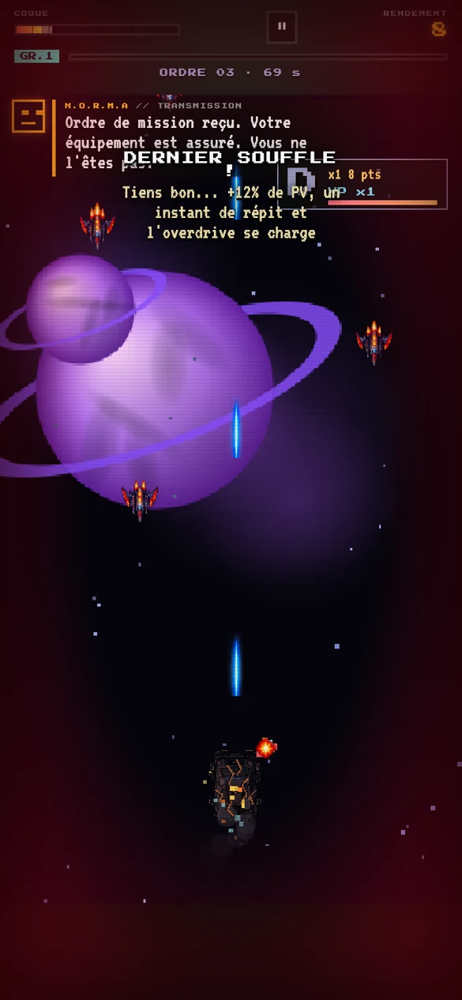 | 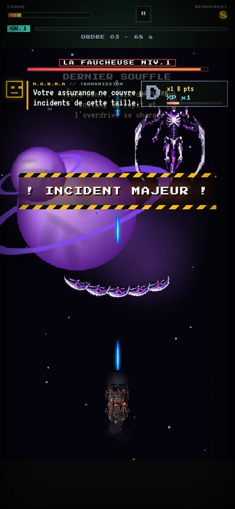 |

### Montée de niveau = réquisition de module
Les cartes d'amélioration deviennent des **fiches de réquisition** (REQ. 01, REQ. 02…), « Choisir un (1) module. Aucun remboursement. », avec une ligne de N.O.R.M.A.

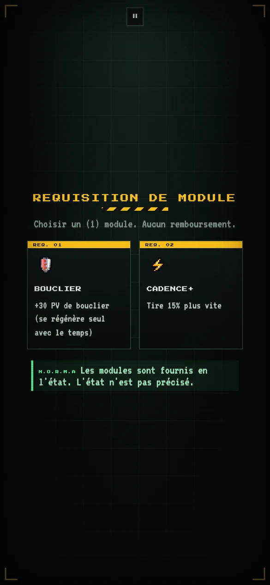

## 5. Rapport d'intervention (fin de mission)
Le résultat est un **document imprimé** qui sort ligne à ligne (listing à perforations), les chiffres défilent, un **tampon claque** (INTERVENTION VALIDÉE / ACCIDENT DU TRAVAIL / ORDRE ANNULÉ), puis N.O.R.M.A. commente en direct. L'évaluation de performance reprend le rang de style (D → SSS) avec une mention administrative (« INSUFFISANT » … « SUSPECT : AUDIT EN COURS »).

| Intervention validée | Accident du travail |
|---|---|
| 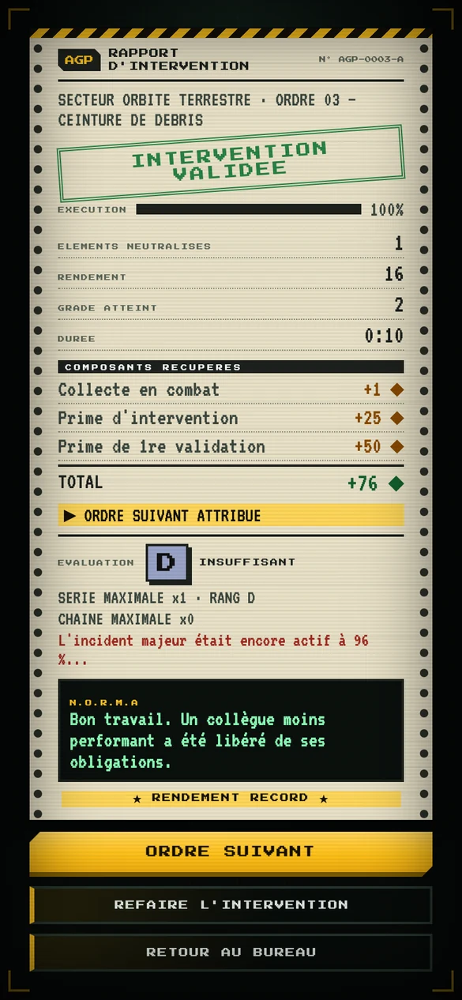 | 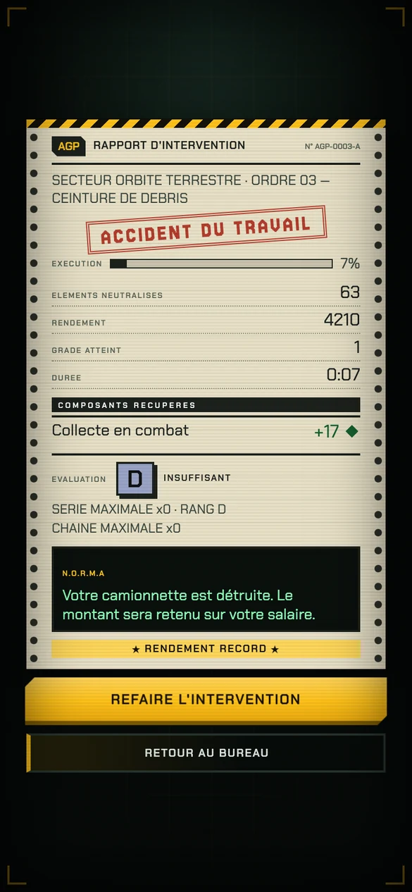 |

Boutons : **ORDRE SUIVANT · REFAIRE L'INTERVENTION · RETOUR AU BUREAU**.

## 6. Le tutoriel (ordre n°1)
« FORMATION OBLIGATOIRE » : N.O.R.M.A. accueille le joueur (« Évitez de mourir (non couvert) »), l'écran de fin devient FORMATION VALIDÉE / ACCIDENT DU TRAVAIL.

| En cours | Fin |
|---|---|
| 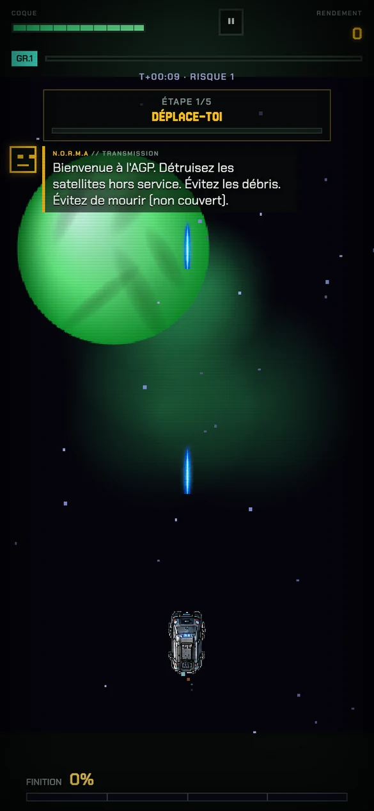 | 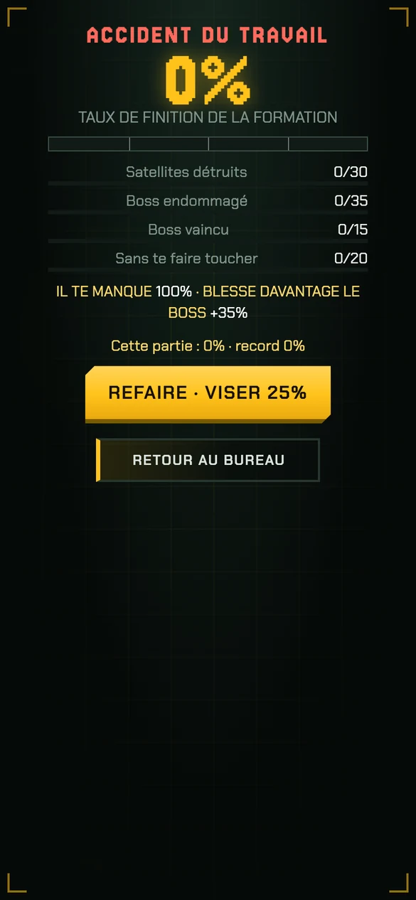 |

## 7. N.O.R.M.A. — règles de la voix
Assistante administrative embarquée : **froide, polie, sarcastique, jamais méchante**. Tout est dans `src/data/agp-lore.js` (`AGP_LINES`), à enrichir librement :
- `ticker` (accueil), `start` / `startTuto`, `boss`, `lowhp`, `cards` (réquisition), `win` / `lose` / `abort` / `hiGrade` (rapport).
- **Jamais plus d'une transmission à la fois**, 14 s minimum entre deux messages « libres » (sauf début de mission, boss et coque critique, qui sont prioritaires). Pas de message pendant le décollage.
- Exemples : « Votre équipement est assuré. Vous ne l'êtes pas. » · « Une légère résistance a été détectée. Merci d'éviter toute escalade. » · « Accident du travail constaté. Il sera requalifié en imprudence personnelle. »

## 8. Où est le code
| Fichier | Rôle |
|---|---|
| `css/agp.css` (nouveau) | toute la couche visuelle (palette, composants, HUD, rapport). Chargé après `style.css` : le retirer de `index.html` rend l'ancienne apparence. |
| `css/style.css` | les couleurs « en dur » (violet/cyan/magenta) ont été remplacées par la palette AGP. |
| `src/data/agp-lore.js` (nouveau) | tous les textes : dossiers, types d'ordres, départements R&D, grades, lignes de N.O.R.M.A. |
| `src/ui/norma.js` (nouveau) | transmissions (file, délais, machine à écrire), bandeau de l'accueil, déclencheurs en jeu (`normaStart/Boss/Low`). |
| `src/home/ui.js`, `galaxy.js`, `ui/tree-ui.js`, `ui/hud.js`, `game/run.js`, `ui/motion.js`, `index.html`, `boot.js` | textes, fiche d'ordre, rapport, animations. |

Tests mis à jour (nouveaux libellés) : `home_test.py`, `level_test.py`, `smoke_test.py` passent.

## 9. Assets à produire (aujourd'hui : solutions temporaires en CSS/texte)
1. **Logo AGP** (pixel art, 32×32 et 64×64) — remplace le carré jaune « AGP » en CSS.
2. **Visage de N.O.R.M.A.** (sprite 4 états : repos, parle, sourit, « désapprouve ») — aujourd'hui un petit visage dessiné en CSS.
3. **Tampons** (VALIDÉ, ACCIDENT, ANNULÉ) en pixel art, avec encrage irrégulier.
4. **Fond de papier listing** (texture légère) et trame de l'atelier (établi, outils, affiches de sécurité).
5. **Icônes de département** (8) pour les onglets R&D — aujourd'hui les emojis pixelisés existants.
6. **Sons** : bip de transmission de N.O.R.M.A., impression du rapport (ligne par ligne), tampon, validation d'un ordre.
7. **Planche de pictos « formulaire »** : cases à cocher, flèches, codes-barres.

## 10. Idées qui toucheraient au gameplay (non faites, à discuter)
- **Primes / retenues sur salaire** : les composants gagnés pourraient être « réduits » par des frais (assurance, amende de sécurité) selon les dégâts subis → nouvelle économie.
- **Notation RH** qui influence les ordres proposés (employé modèle = ordres plus rémunérés).
- **Syndicat / pétitions** : mini-événements en combat (un drone « gréviste » ne tire plus) — nouvel ennemi.
- **Heures supplémentaires** : mode infini présenté comme une prolongation non rémunérée avec bonus croissant.
- **Révélations de la conspiration** : documents « retirés » à collectionner entre les ordres (collection existante, nouveau contenu).

## 11. À retenir pour la suite
- La **lisibilité en combat** passe avant : toute nouvelle info va dans la bande du haut et reste semi-transparente.
- Les textes accentués sont en VT323 ; les titres en Press Start sont **sans accents** (convention du jeu).
- Ajouter un secteur = ajouter ses lignes dans `AGP_LORE.files` (dossier, note de service) ; sans entrée, une note par type d'ordre est utilisée.
