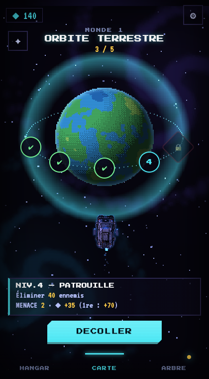
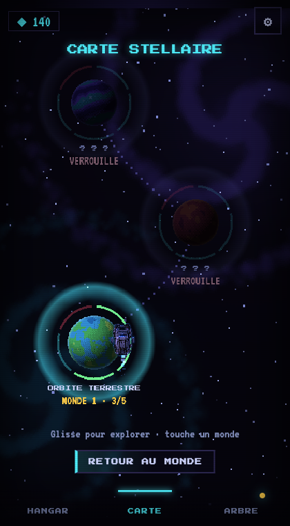
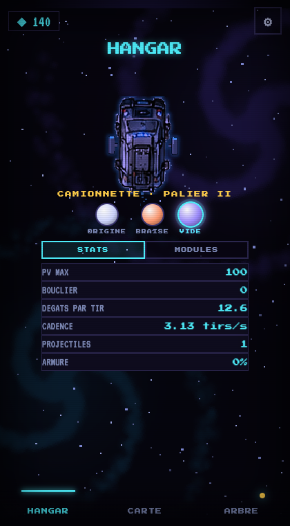
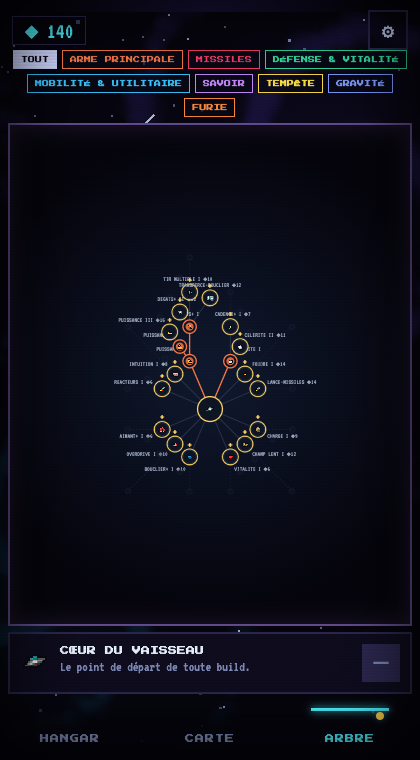
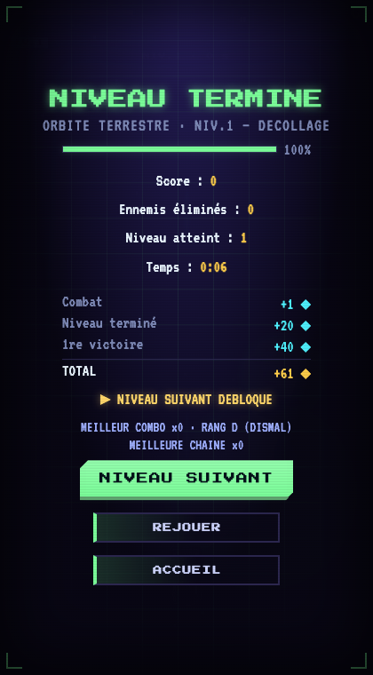
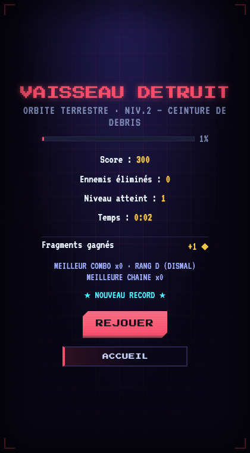

# Menu d'accueil, mondes et progression

Le jeu n'est plus une partie infinie : on voyage de **monde en monde** (Monde → Niveaux → Boss → Monde suivant), depuis un accueil animé à trois pages.
Pour le voir : `python3 tools/serve.py 8080` puis <http://localhost:8080/> (ou `?dev` pour tout débloquer + le bouton DEV qui rouvre l'ancien menu : partie infinie, bac à sable, choix d'un niveau).

## Les écrans

| Carte d'un monde | Carte stellaire |
|---|---|
|  |  |
| La planète du monde, ses niveaux en orbite (✔ fait · numéro ouvert · 🔒 · ☠ boss), la fiche du niveau et **DECOLLER**. ✦ = carte stellaire. | Tous les mondes sur une route sinueuse. On fait défiler au doigt (inertie), on touche un monde pour zoomer dessus. Un monde verrouillé tremble. |

| Hangar | Arbre de compétences |
|---|---|
|  |  |
| La camionnette, son palier, **3 apparences** (teintes), et STATS / MODULES (compétences installées). | Page permanente (onglet en bas à droite) : un onglet par branche, une carte par compétence (rangs en pastilles), paliers puis voies spécialisées, fiche + ACHETER en bas. Il ne s'ouvre plus tout seul à la mort. L'image ci-contre montre l'ancien arbre radial. |

| Victoire | Défaite |
|---|---|
|  |  |
| Récompenses détaillées, déblocages, **NIVEAU SUIVANT** / REJOUER / ACCUEIL. | Progression atteinte, fragments **conservés**, REJOUER / ACCUEIL. |

## Parcours
**Le tuto est le niveau 1 du monde 1** (`w1-tuto`, nœud « ? », type `tuto`) : satellites à détruire, débris à esquiver, boss satellite (`src/game/tuto.js`). Toujours visible et rejouable ; sa 1re victoire donne des fragments et ouvre DECOLLAGE, puis retour à l'accueil. Parcours normal :
Accueil (page CARTE) → choisir un niveau → DECOLLER → niveau (objectif : survivre X s, éliminer N ennemis, récolter N cristaux, ou vaincre le boss du monde) → écran de résultat → SUIVANT / REJOUER / ACCUEIL.
Navigation : glisser le doigt gauche/droite (ou onglets du bas, ou flèches du clavier) entre HANGAR · CARTE · ARBRE. Sur l'arbre, les onglets de branche défilent à l'horizontale : pour changer de page depuis eux, glisser depuis le bord gauche ou toucher un onglet du bas.
Victoire sur un niveau = niveau suivant débloqué ; boss vaincu = monde suivant débloqué (animation : la camionnette voyage jusqu'au nouveau monde). QUITTER dans la pause = niveau abandonné (fragments gagnés gardés).

## Où est le code
| Fichier | Rôle |
|---|---|
| `src/data/worlds.js` (+ `src/data/worlds/monde-*.js`) | Registre et format des mondes/niveaux, validation. **Ajouter un monde = un fichier + une ligne dans `scripts.json`.** |
| `src/data/world-progress.js` | Progression (sauvegarde `ssx_worlds_v1`, déblocages déduits des victoires). |
| `src/game/level.js` | Moteur de niveau : objectif, événements du niveau, victoire. La menace du niveau remplace l'ancien « niveau d'alerte ». |
| `src/scenes/HomeScene.js`, `src/home/` | Accueil : décor + pages (`background.js`), carte stellaire (`galaxy.js`), panneaux (`ui.js`). Panneaux HTML dans `index.html` (`#home`). |
| `src/gfx/planets.js` | Planètes en pixel art générées en code, une palette par monde. |
| `src/data/ship-skins.js`, `src/player/skin.js` | Livrées et pièces cosmétiques de la camionnette ; la couche d'accessoires est affichée dans l'atelier et en mission. |

## Tests
`node tools/check_worlds.js` (format + déblocages) · `python3 tools/level_test.py` (victoire/défaite par type d'objectif, récompenses) · `python3 tools/home_test.py` (pages, carte, arbre, hangar) · `python3 tools/smoke_test.py` (le jeu démarre). Prérequis : `pip install playwright`.

## État
- **Les mondes 1 à 3 sont des brouillons** : durées, menaces et récompenses sont provisoires.
- Un simulateur d'équilibrage existe (`tools/sim_balance.py`, voir son en-tête) : un joueur automatique joue les niveaux ~60× plus vite que le temps réel. Premier constat : avec les valeurs de départ le jeu était trop facile (l'arbre entier s'achetait au début du monde 3) → le revenu de combat en niveau est réduit (`LEVEL_FRAG_MUL` dans `src/data/balance.js`). Le réglage fin niveau par niveau (`hpMul` / `dmgMul`) reste à faire.
- Sons à ajouter (demandés à l'équipe son) : glissement de pages, zoom sur un monde, hyperespace, déblocage d'un monde, jingle « niveau terminé » (aujourd'hui `relicOpen`).
- L'atelier garde une seule camionnette, personnalisable avec trois livrées et trois postes de pièces (toit, marquage, flancs). Les choix sont purement visuels et sauvegardés séparément des modules R&D.

### Garage illustré (27 octobre 2026)

L’atelier utilise désormais `src/home/garage.js`, `css/atelier.css` et les images de `assets/atelier/`. Il remplace l’ancien atelier sans sélecteur de version. Le sprite Phaser de navigation est masqué sur cette page uniquement et revient sur la carte.

Le véhicule et son module partagent le même repère 768 × 820 et la même animation. Placements validés : aimant (349, 273, largeur 310), canon (413, 342, largeur 215). Les sélections restent des apparences du garage, sans effet sur les compétences de mission. Peinture et carrosserie présentent les illustrations du catalogue ; leurs variantes montées restent à produire avec l’utilisateur. La préférence de module est locale (`ssx_atelier_preview_module`). Les sauvegardes précédentes de peinture et d’accessoires restent intactes.

Vérification : affichage mobile, choix/retrait des deux modules, catégories, retour carte, visibilité du sprite de navigation et lancement de mission sans erreur JavaScript.
