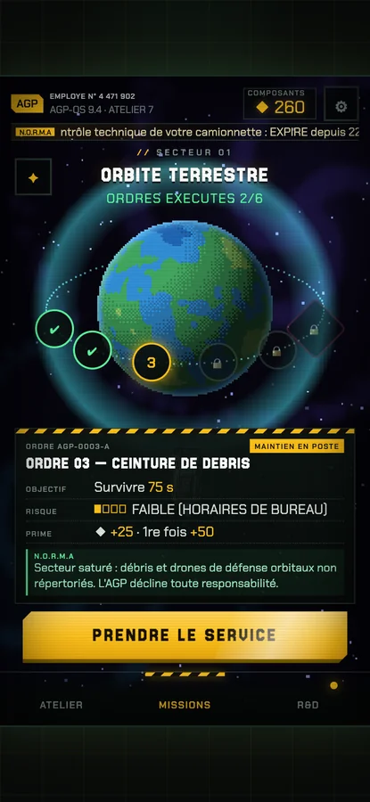
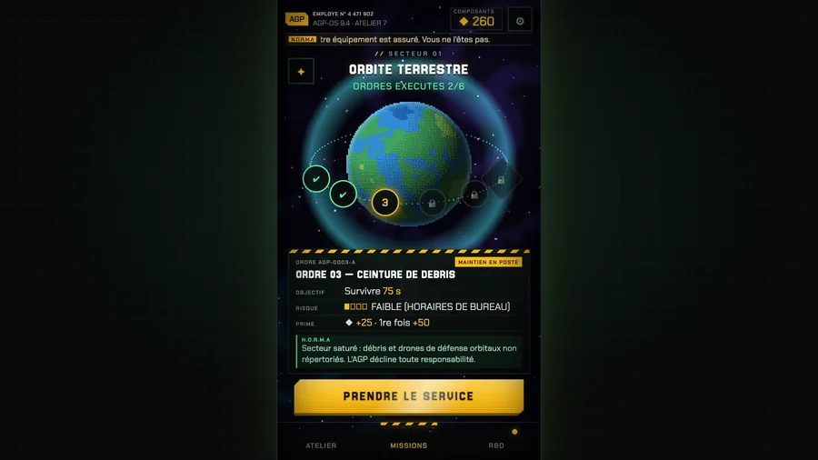

# Responsive : même lisibilité sur téléphone, tablette et PC

## Principe
Le jeu (canevas Phaser **et** tout le HTML : menus, HUD, rapport) vit dans **une zone fixe de 400×700 px logiques** (`#game-container`).
`fitUi()` (`src/main.js`) calcule `s = min(largeur/400, hauteur/700)` et l'applique d'un bloc (`transform: scale(var(--ui-s))`, centré). Phaser est en mode `NONE` (canevas 400×700, c'est le conteneur qui change d'échelle).

Résultat : les proportions sont **identiques partout** ; seul le zoom change. Un texte de 17 px logiques fait ~15 px sur un petit téléphone (360 px de large), ~26 px sur un écran 1080p. Autour de la zone, un fond de poste de travail sombre (grille jaune très discrète).

| Fenêtre | Zone de jeu affichée | Échelle |
|---|---|---|
| 360×640 (petit Android) | 360×630 | 0,90 |
| 390×844 (iPhone) | 390×683 (bandes en haut et en bas) | 0,975 |
| 820×1180 (tablette) | 674×1180 | 1,69 |
| 1920×1080 (PC) | 617×1080 | 1,54 |
| 844×390 (téléphone en paysage) | 223×390 | 0,56 — jouable mais petit : le jeu est conçu en portrait |

Captures (`docs/img/responsive/`) : accueil, atelier et combat sur mobile, petit mobile, tablette, PC et paysage.

| Téléphone 390×844 | PC 1920×1080 |
|---|---|
|  |  |

## Règles pour l'interface
- Tout se dimensionne en **px logiques sur 400×700**. Pas de `vw`, `vh`, `100%` de la fenêtre, ni de `innerWidth` : la fenêtre n'existe pas pour l'interface.
- Les textes les plus petits (labels) ne descendent pas sous 6 px logiques (~8 px écran avec la police du jeu).
- Les zones tactiles gardent ≥ 38 px logiques.
- Les coordonnées des touchers sont recalées par `game.scale.updateBounds()` à chaque changement d'échelle (déjà fait dans `fitUi`).
- Un seuil en pixels écran (glissement de page = 55 px, pincement = 60 px) reste en pixels écran : sur PC, la zone est plus grande, le geste aussi.

## Limites / pistes
- Sur un téléphone très haut (ratio > 2), la zone ne remplit pas tout l'écran (bandes sombres) : la solution propre est un monde de jeu plus haut que 700 px (changement de gameplay/caméra, à discuter).
- Paysage téléphone : zone petite (portrait imposé). Option : message « tournez votre téléphone » ou mise en page à deux colonnes pour l'accueil.
- PC : pas de commandes clavier dédiées au pilotage (souris = doigt). Les flèches ↔ changent de page de l'accueil, Entrée lance la mission.
