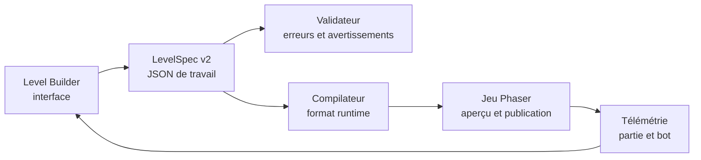

# Space Shooter X — Spécification du Level Builder

**Date :** 28 octobre 2026  
**Statut :** proposition d'architecture prête à découper en tâches  
**Cible :** outil local de conception, de validation et de test des niveaux  
**Point de départ :** `editor.html`, `src/dev/editor-hook.js`, `tools/sim/bot.js`

## 1. But du système

Le Level Builder doit permettre de fabriquer un niveau complet sans modifier le code à la main, puis de vérifier qu'il est jouable avant de le publier dans le jeu.

Il doit gérer :

- le déroulement complet du niveau sur une chronologie ;
- les ennemis disponibles, leur fréquence, leurs vagues et leurs formations ;
- tous les événements, dangers, boss, dialogues et changements d'ambiance ;
- les objectifs et leurs conditions de réussite ou d'échec ;
- les statistiques réelles du bestiaire, dont les PV effectifs à chaque instant ;
- un profil précis du joueur utilisé pour le test ;
- des simulations déterministes avec plusieurs niveaux de compétence ;
- des règles automatiques qui détectent un niveau impossible, incohérent ou trop coûteux ;
- une comparaison mesurable entre la version publiée et le brouillon.

Le builder ne doit jamais exécuter du JavaScript contenu dans un fichier de niveau. Un niveau reste une donnée validée, compilée vers le format utilisé par le jeu.

## 2. Ce que l'éditeur actuel sait déjà faire

L'éditeur actuel est un bon banc de réglage :

- aperçu jouable dans une iframe isolée ;
- joueur automatique dans une seconde iframe ;
- sauvegarde de test séparée de la progression du joueur ;
- réglage de `threat`, `goal`, `hpMul`, `dmgMul` et `reward` ;
- profils de bot `casual`, `average` et `expert` ;
- répétition de parties avec des graines stables ;
- export vers `src/data/tuning.js`.

Il ne construit cependant pas encore le contenu d'un niveau. Les limites actuelles sont :

- les spawns ne sont que des pools activés à partir d'un temps donné ;
- un événement n'accepte que `{ kind, at }` ;
- les événements attendent qu'un emplacement soit libre et ne décrivent pas leur priorité ;
- les conditions autres que le temps ne sont pas disponibles ;
- les statistiques du bestiaire sont dispersées dans les scripts ;
- les formations et les vagues imposées n'existent pas ;
- le bot ne mesure pas les dégâts reçus par source, les pics de charge ou les blocages ;
- l'export écrase seulement les réglages numériques, pas la structure du niveau.

## 3. Décision d'architecture

Le système est divisé en quatre couches.



1. **LevelSpec v2** est la source de vérité éditable.
2. **Le validateur** contrôle les références, les conditions et les budgets.
3. **Le compilateur** produit une définition légère comprise par le runtime.
4. **Le laboratoire de test** joue cette définition sans toucher à la sauvegarde réelle.

Les niveaux actuels restent lisibles. Un adaptateur les transforme en `LevelSpec v2` à l'ouverture. Tant qu'un niveau n'utilise que les fonctions historiques, le compilateur peut encore produire les champs `spawns`, `events`, `goal`, `boss`, `finalBoss` et `zoom` actuels.

## 4. Organisation de l'interface

### 4.1 Écran principal

L'éditeur occupe un écran large et conserve une prévisualisation au format réel **400 × 700**.

| Zone | Contenu |
|---|---|
| Colonne gauche | mondes, niveaux, variantes, statut du brouillon, erreurs |
| Centre haut | chronologie multi-pistes avec zoom et tête de lecture |
| Centre bas | prévisualisation jouable ou lecture accélérée |
| Colonne droite | inspecteur de l'élément sélectionné |
| Bandeau inférieur | laboratoire de test, résultats, comparateur et journal |

### 4.2 Manipulations indispensables

- glisser un élément depuis le catalogue vers la chronologie ;
- déplacer, dupliquer, désactiver ou verrouiller un élément ;
- éditer plusieurs éléments ensemble ;
- copier une phase d'un niveau vers un autre ;
- annuler et rétablir au moins 100 opérations ;
- sélectionner plusieurs événements avec un rectangle ;
- saisir une valeur précise au clavier après un placement à la souris ;
- poser un marqueur pendant une partie de test puis revenir directement à ce moment ;
- afficher le niveau en secondes, en progression d'objectif ou par phases ;
- masquer les pistes pour travailler sur une famille d'éléments ;
- afficher la version publiée en fantôme derrière le brouillon.

### 4.3 Pistes de chronologie

1. **Phases** : introduction, montée, pression, respiration, climax, boss, sortie.
2. **Pools de spawn** : ennemis tirés aléatoirement et poids de tirage.
3. **Vagues** : groupes imposés, ordre, formation et délai entre unités.
4. **Événements** : tempêtes, essaims, mines, effets de visibilité et dangers.
5. **Objectifs** : objectif principal, sous-objectifs et checkpoints.
6. **Boss** : apparition, phases, renforts et fin du combat.
7. **Narration** : N.O.R.M.A., annonces, tutoriel et texte de secteur.
8. **Mise en scène** : fond, zoom, caméra, musique, lumière et transition.
9. **Récompenses** : composants, plans, pièces de secteur et bonus optionnels.
10. **Repères de test** : assertions, captures et points de mesure.

## 5. Format `LevelSpec v2`

Le format de travail est du JSON strict. Tous les identifiants sont stables afin de produire des diffs Git lisibles.

```json
{
  "schemaVersion": 2,
  "id": "w2-l2",
  "name": "TRI SELECTIF",
  "world": "w2",
  "type": "kill",
  "environment": {
    "background": "debris",
    "intro": "short",
    "music": "sector-2",
    "zoom": { "start": 1, "end": 0.86, "seconds": 50 }
  },
  "rules": {
    "threat": 4,
    "hpMul": 1.1,
    "dmgMul": 1,
    "spawnIntervalMul": 1,
    "enemyCap": 40
  },
  "goal": {
    "type": "kill",
    "target": 80,
    "timeLimit": 210,
    "failure": { "playerDead": true }
  },
  "phases": [
    {
      "id": "phase-opening",
      "name": "Prise en main",
      "start": { "type": "level-start" },
      "end": { "type": "time", "seconds": 25 }
    },
    {
      "id": "phase-pressure",
      "name": "Pression",
      "start": { "type": "goal-progress", "value": 0.35 },
      "end": { "type": "goal-progress", "value": 0.8 }
    }
  ],
  "timeline": [
    {
      "id": "pool-opening",
      "type": "spawn-pool",
      "trigger": { "type": "level-start" },
      "action": {
        "mode": "replace",
        "entries": [
          { "enemy": "grunt", "weight": 7 },
          { "enemy": "drone", "weight": 3 }
        ]
      }
    },
    {
      "id": "wave-crossfire",
      "type": "wave",
      "trigger": {
        "all": [
          { "type": "time", "seconds": 32 },
          { "type": "active-enemies-below", "count": 8 }
        ]
      },
      "action": {
        "formation": "two-columns",
        "units": [
          { "enemy": "shooter", "count": 2, "hpMul": 1 },
          { "enemy": "swarmer", "count": 6, "hpMul": 0.9 }
        ],
        "spacingMs": 180
      }
    },
    {
      "id": "event-meteors",
      "type": "event",
      "trigger": { "type": "goal-progress", "value": 0.5 },
      "action": {
        "event": "meteors",
        "durationMs": 18000,
        "intensity": 0.8
      },
      "policy": { "once": true, "priority": 50, "onConflict": "queue" }
    },
    {
      "id": "norma-warning",
      "type": "narration",
      "trigger": { "type": "event-started", "eventId": "event-meteors" },
      "action": {
        "speaker": "norma",
        "text": "TRAJECTOIRES INSTABLES. GARDE LE COULOIR CENTRAL.",
        "durationMs": 3800
      }
    }
  ],
  "rewards": {
    "clear": 70,
    "first": 160,
    "drops": [
      { "item": "sector-2-part", "chance": 0.15, "maxPerRun": 1 }
    ]
  },
  "testSpec": {
    "preset": "progression-reelle",
    "seeds": [1000, 1037, 1074, 1111, 1148],
    "maxSeconds": 240,
    "assertions": [
      { "metric": "winRate.average", "min": 0.65, "max": 0.9 },
      { "metric": "completion.p95", "max": 180 },
      { "metric": "unreachableTriggers", "equals": 0 }
    ]
  }
}
```

## 6. Déclencheurs

Chaque élément de chronologie possède un déclencheur. Les déclencheurs se combinent avec `all`, `any` et `not`.

### 6.1 Déclencheurs de base

| Déclencheur | Paramètres | Exemple d'usage |
|---|---|---|
| `level-start` | aucun | pool initial |
| `time` | secondes | événement à 30 s |
| `phase-started` | id de phase | musique de pression |
| `goal-progress` | valeur 0..1 | renforts à 50 % |
| `kills` | total ou type d'ennemi | vague après 20 ennemis |
| `gems-collected` | quantité | sous-objectif |
| `active-enemies-below` | quantité | éviter une vague surchargée |
| `active-enemies-above` | quantité | secours ou nettoyage |
| `player-hp-below` | ratio | respiration d'urgence |
| `player-shield-below` | ratio | message N.O.R.M.A. |
| `event-started` | id d'élément | synchronisation narrative |
| `event-ended` | id d'élément | reprise de la musique |
| `wave-cleared` | id de vague | enchaînement précis |
| `enemy-killed` | id d'instance ou type | miniboss vaincu |
| `boss-hp-below` | ratio et boss | changement de phase |
| `boss-phase` | phase | renforts du boss |
| `flag` | nom et valeur | logique de scénario |
| `checkpoint-reached` | id | reprise de test |

### 6.2 Politique d'exécution

Chaque élément peut définir :

- `once` : ne se produit qu'une fois ;
- `repeat` : nombre de répétitions ou répétition infinie bornée par la phase ;
- `cooldownMs` : délai entre deux exécutions ;
- `delayMs` : délai après validation du déclencheur ;
- `timeoutMs` : abandon si l'action n'a pas pu commencer ;
- `priority` : ordre de résolution à déclenchement égal ;
- `onConflict` : `queue`, `skip`, `replace` ou `parallel` ;
- `cancelWhen` : condition qui annule une action en attente ;
- `enabled` : désactivation temporaire sans suppression.

Les déclencheurs sont évalués sur des faits de jeu, jamais sur une fonction personnalisée saisie dans l'éditeur.

## 7. Actions disponibles

| Famille | Actions |
|---|---|
| Spawn | remplacer, ajouter ou retirer un pool ; modifier les poids ; suspendre ou reprendre le spawn |
| Vague | générer une formation ; espacer les unités ; affecter PV, vitesse et dégâts à la vague |
| Événement | démarrer, arrêter, prolonger ou modifier l'intensité |
| Objectif | définir l'objectif principal ; ajouter une étape ; mettre à jour une jauge |
| Boss | faire apparaître un boss ou miniboss ; changer de phase ; appeler des renforts |
| Niveau | changer menace, cadence, plafond d'ennemis ou multiplicateurs |
| Mise en scène | zoom, caméra, fond, lumière, musique, alerte et transition |
| Narration | message N.O.R.M.A., sous-titre, tutoriel, avertissement |
| Récompense | composant, plan, pièce, multiplicateur ou bonus conditionnel |
| Contrôle | poser un flag, ouvrir un checkpoint, terminer ou faire échouer le niveau |

## 8. Vagues et formations

Les vagues imposées coexistent avec le pool aléatoire. Elles peuvent suspendre le pool, s'y ajouter ou attendre que l'écran soit dégagé.

Formations proposées :

- ligne horizontale ou verticale ;
- V ouvert ou fermé ;
- arc ;
- deux colonnes ;
- alternance gauche/droite ;
- encerclement ;
- anneau ;
- grille ;
- essaim serré ;
- file indienne ;
- entrée par les flancs ;
- points libres placés dans une zone normalisée 0..1.

Une vague contient des unités ordonnées. Chaque unité accepte :

- type d'ennemi et quantité ;
- position ou zone de spawn ;
- délai relatif ;
- multiplicateurs de PV, bouclier, dégâts et vitesse ;
- comportement d'entrée ;
- identifiant d'instance utile à un déclencheur ;
- drop forcé ou table de drop ;
- drapeau `required` indiquant si sa mort est nécessaire à la fin de la vague.

## 9. Registre du bestiaire

### 9.1 Source commune

Créer un registre `ENEMY_CATALOG` utilisé par l'éditeur et consultable par le jeu. Dans un premier temps, il reflète les constantes existantes sans changer le comportement. Ensuite seulement, les statistiques pourront être déplacées vers ce registre.

Chaque entrée contient :

```js
{
  id, label, family, role, source,
  baseHp, baseShield, contactDamage,
  score, spawnable, summonedOnly, eventOnly,
  recommendedThreat, tags, editorWarnings,
  asset, animation, body,
  defaultBehavior
}
```

L'éditeur distingue clairement :

- **valeur globale** : statistique de référence du bestiaire ;
- **multiplicateur de niveau** : `threat`, `hpMul`, temps et alerte ;
- **multiplicateur d'instance** : uniquement la vague sélectionnée.

Modifier les PV d'une vague ne doit jamais modifier le bestiaire entier.

### 9.2 Ennemis standards actuellement spawnables

Les valeurs suivantes sont les bases trouvées dans `src/enemies/spawning.js`. Les PV réels sont recalculés au moment du spawn.

| Id | Rôle | PV de base | Bouclier de base | Dégâts de contact |
|---|---|---:|---:|---:|
| `grunt` | soldat simple | 12 | 0 | 8 |
| `shooter` | tireur | 20 | 0 | 10 |
| `drone` | mobile latéral | 9 | 0 | 8 |
| `tank` | lourd | 60 | 0 | 16 |
| `swarmer` | essaim rapide | 5 | 0 | 6 |
| `diver` | charge directe | 8 | 0 | 10 |
| `turret` | tir stationnaire | 25 | 0 | 4 |
| `splitter` | se divise | 18 | 0 | 8 |
| `splitterMini` | enfant du splitter | 6 | 0 | 5 |
| `shieldedGrunt` | soldat protégé | 10 | 15 | 9 |
| `mine` | poseur de mines | 20 | 0 | 22 |
| `sat` | satellite mobile | 22 | 0 | 9 |
| `satgun` | satellite armé | 32 | 0 | 8 |
| `bras` | bras industriel | 60 | 0 | 10 |
| `pilleur` | pilleur lourd | 90 | 0 | 9 |
| `eclaireur` | faisceau longue portée | 80 | 0 | 9 |
| `bomber` | bombardier | 16 | 0 | 8 |
| `sniper` | tir télégraphié | 14 | 0 | 6 |
| `healer` | soutien | 12 | 0 | 6 |
| `ghost` | phasage | 16 | 0 | 10 |
| `elite` | élite lourde | 120 | 0 | 20 |
| `mothership` | invoque des unités | 45 | 0 | 10 |
| `vortex` | contrôle de zone | 30 | 0 | 5 |
| `golden` | cible à récompense | 10 | 0 | 1 |
| `kamikaze` | explosion | 14 | 0 | 1* |
| `spider` | groupe et toile | 18 | 0 | 9 |
| `charo` | attaquant agressif | 24 | 0 | 11 |

`*` Le kamikaze inflige surtout les dégâts définis par son explosion. Le builder doit afficher séparément contact, projectile, zone et effet persistant.

Les entités invoquées ou événementielles, comme `mineDeployed`, les météorites, les segments de boss et les leurres, apparaissent dans un onglet séparé. Elles ne peuvent pas être ajoutées à un pool standard si leur cycle de vie dépend d'un parent.

### 9.3 Calcul des PV affichés

Pour un ennemi standard, l'éditeur affiche les PV de base et les PV effectifs à la tête de lecture :

```text
PV effectifs = PV de base
             × multiplicateur de menace et de temps
             × hpMul du niveau
             × multiplicateur de la vague
```

Le calcul actuel du jeu comprend notamment :

```text
hpScaleNow = (1 + difficultyTier × 0,2)
           × croissance tardive
           × bonus d'alerte au-dessus de 4
           × hpMul du niveau
```

À partir des menaces élevées, le bouclier automatique doit également apparaître dans l'inspecteur. Les PV de coque, les PV de bouclier et les PV totaux sont présentés dans trois colonnes distinctes.

### 9.4 Boss

Deux familles doivent être distinguées.

**Boss génériques soumis à la formule de boss :**

| Id | PV de définition |
|---|---:|
| `dread` | 630 |
| `faucheuse` | 700 |
| `prisme` | 680 |
| `kraken` | 600 |
| `eclipse` | 720 |
| `ruche` | composite |
| `hydre` | composite |

Leur total réel dépend de la menace, du temps, du rang du boss, du mode double boss et de `hpMul`.

**Boss scénarisés :**

| Id | PV de base | Éléments liés |
|---|---:|---|
| antenne du tutoriel | 700 | satellites à 30 PV |
| `meteo` | 1 000 | dangers météorites |
| `araignee` | 1 000 | toile et araignées |
| `reacteur` | 1 000 | flaques et projectiles persistants |
| `anneau` | 1 100 | rayons et baies |
| `pdg` | 1 200 | vaisseaux à 160 PV, gardes à 220 PV |

Pour un boss composite, l'éditeur affiche les PV du cœur, de chaque partie, le total destructible et les éléments invulnérables. Il doit avertir lorsqu'un seuil de phase ne peut pas être atteint à cause d'une partie encore invulnérable.

## 10. Registre des événements

Les 22 événements actuels doivent être disponibles dans le catalogue :

| Id | Nom | Slot actuel |
|---|---|---|
| `crystal` | pluie de cristaux | grand |
| `meteors` | tempête de météorites | grand |
| `swarm` | marée d'essaims | petit |
| `mines` | champ de mines | grand |
| `goldrush` | ciel de trésorins | petit |
| `kamikaze` | escadron kamikaze | petit |
| `spiders` | forêt d'araignées | grand |
| `elite` | escorte d'élites | petit |
| `bombard` | bombardement | petit |
| `frenzy` | frénésie | grand |
| `flip` | écran retourné | grand |
| `nebula` | nébuleuse | grand |
| `bossbonus` | boss bonus | petit |
| `minibh` | mini trous noirs | grand |
| `bigbh` | trou noir | grand |
| `corridor` | couloir d'astéroïdes | grand |
| `eclipse` | éclipse solaire | grand |
| `emp` | impulsion EMP | petit |
| `statik` | foudre statique | petit |
| `ice` | tempête de glace | petit |
| `shieldwall` | invaders | petit |
| `plasma` | boule de plasma | petit |

Le registre est généré automatiquement depuis `EVENT_DEFS` pour éviter que l'éditeur et le jeu divergent.

Chaque définition d'événement reçoit des métadonnées d'édition :

- slot `large` ou `small` ;
- menace minimale ;
- paramètres modifiables et leurs bornes ;
- durée par défaut ;
- cadence par défaut ;
- coût de performance estimé ;
- incompatibilités ;
- nécessité d'un fond, d'une texture ou d'un son ;
- comportement en présence d'un boss ;
- éléments restant à nettoyer à la fin.

Le runtime devra accepter des paramètres d'instance. Au minimum :

- `durationMs` ;
- `intensity` ;
- `tickMs` ou cadence ;
- `count` ;
- `warningMs` ;
- `rewardMul` ;
- `cleanupPolicy`.

Le builder ne montre que les paramètres déclarés par l'événement. Il est impossible de saisir une clé libre ignorée silencieusement par le jeu.

## 11. Objectifs et fins de niveau

Les objectifs historiques restent disponibles : survie, éliminations, collecte et boss. Le format v2 ajoute :

- séquence de plusieurs objectifs ;
- objectifs simultanés obligatoires ou optionnels ;
- cible par type d'ennemi ;
- protection d'une entité ;
- maintien dans une zone ;
- destruction d'éléments précis ;
- survie avec limite de dégâts ;
- collecte avant une échéance ;
- score minimal ;
- objectif caché donnant une récompense supplémentaire.

Une fin de niveau possède toujours :

- une condition de victoire explicite ;
- une ou plusieurs conditions d'échec ;
- un délai de nettoyage ;
- une politique concernant les ennemis encore vivants ;
- une sortie visuelle et sonore ;
- un calcul de finition documenté.

Le validateur refuse tout niveau dont la victoire n'est reliée à aucune condition atteignable.

## 12. Laboratoire de test

### 12.1 Profil de joueur

Un test enregistre exactement l'état du joueur :

- progression et niveau d'expérience ;
- composants disponibles ;
- rang de chaque poste de l'atelier ;
- technologies R&D débloquées ;
- spécialisation ;
- baies d'équipement et assemblage choisi ;
- politique de choix des cartes pendant la mission ;
- PV ou bouclier de départ forcés ;
- éventuels handicaps de test.

Les presets recommandés sont :

1. **Entrée de secteur** : minimum réaliste à l'arrivée dans le secteur.
2. **Progression réelle** : état moyen estimé à ce niveau.
3. **Sans amélioration** : détecte les dépendances cachées.
4. **Défensif** : achat prioritaire coque et bouclier.
5. **Offensif** : achat prioritaire canon et technologies de dégâts.
6. **Secteur terminé** : équipement maximal raisonnable à ce point.
7. **Maximum développeur** : recherche des boucles cassées.

### 12.2 Compétence du pilote

Chaque profil définit :

- sensibilité de déplacement ;
- temps de réaction ;
- imprécision ;
- propension à prendre un risque pour une gemme ;
- aptitude à anticiper les zones télégraphiées ;
- connaissance des phases de boss ;
- politique de choix des cartes ;
- fréquence des erreurs volontaires.

Conserver `casual`, `average` et `expert`, puis ajouter `new-player` et `perfect-dodge` pour borner les résultats.

### 12.3 Reproductibilité

Chaque campagne de test stocke :

- hash du `LevelSpec` ;
- hash du profil de joueur ;
- version du jeu ;
- liste des graines ;
- vitesse de simulation ;
- date et plateforme ;
- limite de temps ;
- résultat brut de chaque partie.

Une graine doit contrôler le tirage des spawns, les événements, les positions et les choix du bot. Rejouer une graine doit permettre de retrouver le même incident.

### 12.4 Télémétrie à collecter

| Groupe | Mesures |
|---|---|
| Résultat | victoire, défaite, timeout, progression finale, finition |
| Temps | durée totale, durée par phase, temps du boss, temps sans ennemi |
| Joueur | PV minimum, dégâts reçus, bouclier perdu, morts, déplacements |
| Combat | DPS réel, tirs touchés, ennemis tués par type, temps pour tuer |
| Danger | dégâts par contact, projectile, zone, événement et boss |
| Densité | ennemis simultanés, projectiles simultanés, objets physiques |
| Événements | début, fin, attente, conflit, chevauchement et nettoyage |
| Économie | XP, cartes, composants, plans et pièces obtenus |
| Performance | temps de frame simulé, pic d'entités, allocations critiques |
| Logique | déclencheurs jamais atteints, actions annulées, file bloquée |

La chronologie de résultat superpose : PV joueur, nombre d'ennemis, densité de projectiles, progression, événements et phases. Cliquer un pic relance la graine à proximité de ce moment.

### 12.5 Assertions de niveau

Une spécification de test peut imposer :

- taux de victoire minimal et maximal par profil ;
- durée médiane, p10, p90 ou p95 ;
- progression minimale en cas de défaite ;
- durée maximale d'un boss ;
- nombre maximal d'ennemis ou de projectiles simultanés ;
- dégâts inévitables égaux à zéro pour `perfect-dodge` ;
- aucun temps mort supérieur à une durée donnée ;
- aucun déclencheur obligatoire non atteint ;
- aucun événement exclusif superposé ;
- finition 100 % réellement atteignable ;
- récompense moyenne dans une plage donnée ;
- absence de blocage après la mort d'un parent invoquant des unités ;
- absence de différence avec une référence au-delà d'une tolérance.

Exemple de matrice de validation avant publication :

| Profil | Parties | Résultat attendu |
|---|---:|---|
| `new-player` + entrée de secteur | 30 | 20–55 % de victoires |
| `casual` + progression réelle | 50 | 45–70 % |
| `average` + progression réelle | 50 | 65–90 % |
| `expert` + progression réelle | 30 | 85–100 % |
| `perfect-dodge` + sans amélioration | 10 | aucun dégât inévitable |

Ces plages sont des valeurs de départ. Elles doivent devenir des presets configurables par secteur et par type de niveau.

## 13. Validation automatique

### 13.1 Erreurs bloquantes

- identifiant dupliqué ou référence absente ;
- type d'ennemi, boss, événement, asset ou musique inconnu ;
- déclencheur circulaire ;
- déclencheur obligatoire impossible à atteindre ;
- objectif de collecte sans source suffisante ;
- objectif d'élimination supérieur au nombre maximal d'ennemis produits ;
- boss non déclenché dans un niveau boss ;
- victoire sans condition ;
- événement demandant un paramètre hors limites ;
- entité invoquée utilisée comme ennemi autonome ;
- JSON non conforme au schéma ;
- publication d'un niveau dont les tests bloquants échouent.

### 13.2 Avertissements

- longue période sans pression ;
- pic de densité supérieur au budget cible ;
- événement grand slot chevauché par un autre ;
- boss présent pendant un événement incompatible ;
- multiplication de PV très éloignée des niveaux voisins ;
- variation de difficulté trop brutale entre deux phases ;
- texte N.O.R.M.A. affiché pendant une alerte prioritaire ;
- récompense éloignée de la courbe du secteur ;
- formation partiellement hors de la zone visible au zoom choisi ;
- référence à un contenu encore verrouillé à ce niveau de progression ;
- résultat statistique trop incertain faute de parties.

### 13.3 Estimation statique

Avant même de lancer le bot, le builder calcule :

- nombre attendu de spawns par phase ;
- somme pondérée de PV à détruire ;
- DPS ennemi théorique ;
- temps moyen de destruction avec le profil choisi ;
- quantité attendue de gemmes et de récompenses ;
- coût maximal estimé en entités ;
- courbe de pression seconde par seconde.

Cette estimation sert à détecter les erreurs grossières. Le bot reste l'autorité pour la jouabilité réelle.

## 14. Brouillons, sauvegarde et publication

### 14.1 Emplacements recommandés

```text
docs/level-builder/drafts/       JSON de travail non publié
docs/level-builder/reports/      rapports de tests exportés
src/data/levels/                 définitions runtime publiées
tools/level-builder/             interface, compilateur et validateur
```

### 14.2 États d'un niveau

- `draft` : modifiable, tests facultatifs ;
- `testable` : schéma valide et aperçu lançable ;
- `validated` : campagne obligatoire réussie ;
- `published` : version utilisée par le jeu ;
- `changed` : brouillon différent de la version publiée.

### 14.3 Sauvegarde

- autosauvegarde locale après chaque opération ;
- sauvegarde JSON explicite via le serveur local ;
- historique de versions avec date, auteur et commentaire ;
- import et export d'un niveau ou d'un monde ;
- diff lisible avant publication ;
- sauvegarde automatique de la version publiée précédente ;
- aucun accès à la sauvegarde réelle du joueur pendant un test.

L'API locale étend `tools/serve.py` avec des routes limitées à des dossiers autorisés :

```text
GET  /__level-builder/list
GET  /__level-builder/load?id=w2-l2
POST /__level-builder/draft
POST /__level-builder/validate
POST /__level-builder/publish
POST /__level-builder/report
```

Le serveur refuse les chemins fournis par le client et reconstruit lui-même chaque chemin depuis un identifiant validé.

## 15. Intégration au runtime

### 15.1 Compilateur

Le compilateur transforme :

- les phases et déclencheurs en objets légers ;
- les formations en positions normalisées ;
- les références de catalogue en identifiants runtime ;
- les paramètres d'événement en valeurs bornées ;
- les dialogues en entrées de narration ;
- les assertions en données de test exclues du jeu de production.

Le fichier publié ne contient ni historique, ni captures, ni résultats du bot.

### 15.2 Moteur de scénario

Créer un petit moteur de scénario dans la scène de jeu :

- indexe les éléments par déclencheur ;
- évalue uniquement les conditions susceptibles d'avoir changé ;
- place les actions en file selon leur priorité ;
- trace chaque déclenchement en mode éditeur ;
- n'effectue aucune allocation importante chaque frame ;
- sait nettoyer les actions lors d'une victoire, d'une défaite ou d'un redémarrage.

### 15.3 Compatibilité

La migration se fait sans réécrire tous les niveaux d'un coup :

1. lecture du format actuel ;
2. conversion en mémoire vers v2 ;
3. édition et test ;
4. publication au format actuel si les fonctions utilisées le permettent ;
5. publication v2 uniquement lorsqu'un niveau utilise un déclencheur ou une action avancée.

## 16. Découpage technique proposé

```text
tools/level-builder/index.html          coque de l'éditeur
tools/level-builder/css/builder.css     mise en page
tools/level-builder/js/state.js         état, undo/redo, sélection
tools/level-builder/js/schema.js        schéma et migrations
tools/level-builder/js/catalogs.js      accès bestiaire/événements/boss
tools/level-builder/js/timeline.js      pistes et interactions
tools/level-builder/js/inspector.js     formulaires typés
tools/level-builder/js/compiler.js      LevelSpec vers runtime
tools/level-builder/js/validator.js     erreurs, avertissements, estimations
tools/level-builder/js/test-lab.js      campagnes, comparaison, rapports
src/data/enemy-catalog.js               métadonnées communes du bestiaire
src/data/event-editor-meta.js           paramètres et contraintes d'événements
src/dev/level-builder-hook.js           protocole éditeur ↔ jeu
src/game/scenario.js                    déclencheurs et actions runtime v2
```

`editor.html` peut devenir une redirection ou une coque légère vers le nouvel outil. Le réglage numérique existant reste accessible dans l'onglet **Équilibrage**.

## 17. Ordre d'implémentation

### Phase 0 — Audit automatisé des données

- générer le catalogue des ennemis, boss et événements existants ;
- relever statistiques, assets et contraintes ;
- signaler les données présentes dans le code mais absentes des registres ;
- figer un test de non-régression du catalogue.

**Sortie :** le builder peut afficher tout le contenu réel sans le modifier.

### Phase 1 — Format, compilateur et validation

- implémenter `LevelSpec v2` et son schéma ;
- convertir un niveau actuel vers v2 ;
- compiler v2 vers une définition runtime ;
- sauvegarder un brouillon ;
- lancer ce brouillon dans l'iframe ;
- afficher erreurs et avertissements.

**Sortie :** un niveau peut être décrit et testé en JSON, sans chronologie graphique.

### Phase 2 — Chronologie jouable

- créer les pistes phases, pools, vagues et événements ;
- ajouter glisser-déposer, inspecteur, undo/redo et tête de lecture ;
- implémenter les formations ;
- ajouter le journal des déclenchements.

**Sortie :** un niveau classique complet peut être construit visuellement.

### Phase 3 — Bestiaire et événements paramétrables

- afficher PV de base et effectifs ;
- gérer boucliers, dégâts par source et entités invoquées ;
- rendre les paramètres d'événement typés ;
- ajouter contraintes de slots et nettoyage.

**Sortie :** tout le bestiaire et tous les événements existants sont contrôlables.

### Phase 4 — Laboratoire de test

- profils de progression complets ;
- campagnes multi-graines ;
- télémétrie détaillée ;
- assertions et rapport ;
- comparaison brouillon/publié ;
- rejeu d'une graine problématique.

**Sortie :** une décision d'équilibrage possède des preuves reproductibles.

### Phase 5 — Scénario avancé

- conditions combinées ;
- objectifs multiples ;
- narration N.O.R.M.A. ;
- caméra, musique et ambiance ;
- récompenses, plans et pièces de secteur ;
- checkpoints de test.

**Sortie :** le builder couvre un niveau scénarisé et les futurs secteurs.

### Phase 6 — Publication et migration

- workflow de validation ;
- export propre vers `src/data/levels/` ;
- migration progressive des niveaux existants ;
- documentation pour ajouter un ennemi ou un événement ;
- rapport global d'équilibrage par secteur.

**Sortie :** le builder devient le chemin normal de création des niveaux.

## 18. Premier lot conseillé

Le premier lot à coder doit rester petit mais traverser tout le système :

1. ouvrir un niveau existant ;
2. le convertir en `LevelSpec v2` ;
3. afficher son objectif, ses pools et ses événements dans une liste ordonnée ;
4. ajouter une vague de trois ennemis avec une formation ;
5. valider le document ;
6. compiler et lancer le brouillon dans l'iframe ;
7. exécuter cinq graines avec un profil de joueur enregistré ;
8. comparer taux de victoire et durée avec le niveau publié ;
9. sauvegarder le brouillon sans modifier `worlds.js`.

Ce lot valide le modèle de données, la compatibilité du runtime et le protocole de test avant d'investir dans la chronologie graphique complète.

## 19. Critères de réussite du builder

Le système est considéré complet quand :

- chaque ennemi, boss et événement existant apparaît automatiquement dans le catalogue ;
- un niveau peut être construit sans écrire de code ;
- les PV effectifs et les dégâts sont explicables à n'importe quel instant ;
- une condition impossible est détectée avant publication ;
- une graine problématique peut être rejouée ;
- une campagne indique clairement pourquoi un niveau échoue ;
- le brouillon peut être comparé à la version publiée ;
- la publication produit un diff limité aux données du niveau ;
- les niveaux actuels continuent de fonctionner pendant la migration ;
- l'outil n'altère jamais la progression réelle du joueur.
